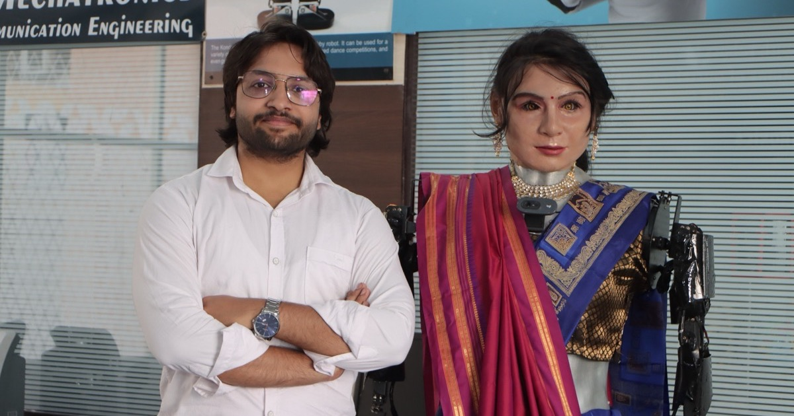

# Piyush Khanna: Portfolio

Source for [piyushkhanna.space](https://piyushkhanna.space), my personal portfolio.

Built with Vite, React, react-three-fiber/drei, Tailwind CSS, Framer Motion, and EmailJS.

## Projects

- **[Anushka](https://piyushkhanna.space/project/anushka)**: a humanoid robot I designed and built over four years, capable of face, object and gesture recognition and multilingual speech interaction.
- **[Emperia Omni](https://piyushkhanna.space/project/omni)**: a natural-language automation harness for Android.
- **[Sunaina](https://piyushkhanna.space/project/sunaina)**: a robotic Durga idol, presiding figure at Chakraberia Sarbojanin Durgotsab, Kolkata, Durga Puja 2025.
- **[DadaShree](https://piyushkhanna.space/project/dadashree)**: a wisdom tree robot deployed at Parasdham, a Jain monastery in Junagadh, Gujarat.
